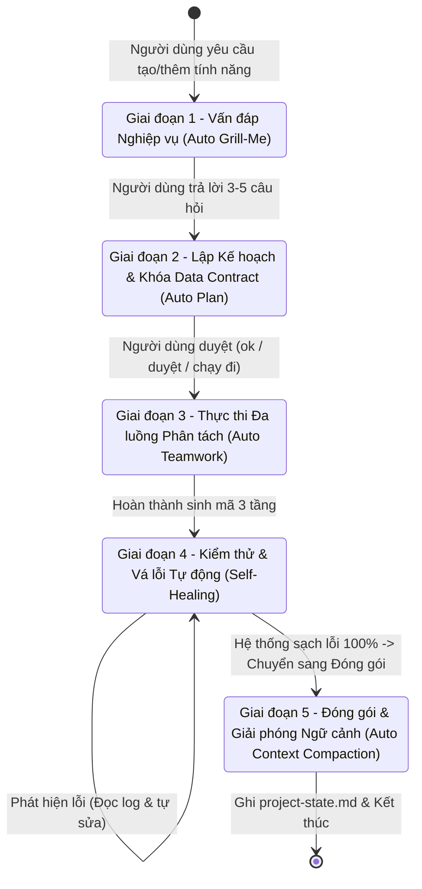

# Quy trình Tự động Phát triển Tính năng ERP (ERP Feature Pipeline)

Quy tắc này luôn được kích hoạt (`trigger: always_on`). Bất cứ khi nào người dùng đưa ra yêu cầu xây dựng tính năng mới (ví dụ: *"Làm chức năng..."*, *"Tạo module..."*, *"Thêm tính năng..."*, *"Xây dựng..."*, *"Phát triển..."*), Agent **BẮT BUỘC** thực thi tuần tự theo State Machine dưới đây. 

> [!CAUTION]
> **NGHIÊM CẤM NHẢY CÓC HOẶC VIẾT CODE TRƯỚC GIAI ĐOẠN 3.** Agent phải hoàn thành và có sự xác nhận của người dùng ở từng giai đoạn trước khi chuyển sang giai đoạn tiếp theo.

---

## Giai đoạn 1: Vấn đáp Nghiệp vụ (Auto Grill-Me)

- **Trạng thái:** Làm rõ yêu cầu & xác định góc khuất nghiệp vụ.
- **Hành vi bắt buộc:**
  1. **TUYỆT ĐỐI KHÔNG** được viết code, sửa file hay tạo migration/model ở bước này.
  2. Đóng vai **Solution Architect**, phân tích yêu cầu từ góc nhìn toàn diện End-to-End (Database, API, Web UI, Mobile App).
  3. Đặt ra **tối đa 3 đến 5 câu hỏi ngắn gọn, sắc bén nhất** nhằm làm rõ:
     - **Edge cases:** Các tình huống biên, dữ liệu rỗng, dữ liệu trùng lặp, logic hoàn tác/hủy bỏ.
     - **Ràng buộc dữ liệu SQLite:** Quan hệ bảng, ràng buộc khóa ngoại (Foreign Keys), cơ chế Soft Delete (`is_deleted`/`deleted_at`), xử lý concurrency/locks.
     - **Phân quyền & Bảo mật:** Vai trò người dùng (Roles/Permissions) được phép xem, thêm, sửa, xóa tính năng này.
     - **Trạng thái UI Web (shadcn):** Trạng thái tải (Loading), bảng rỗng (Empty state), validation form, hành vi Modal (Static + ESC/Enter), Header Left Icon, tiền tệ không có ký hiệu `đ`.
     - **Hành vi App Flutter:** Trải nghiệm offline, đồng bộ dữ liệu, cache cục bộ, phản hồi cảm ứng.
  4. **DỪNG LẠI và chờ** người dùng phản hồi trước khi sang Giai đoạn 2.

---

## Giai đoạn 2: Lập Kế hoạch & Khóa Hợp đồng Dữ liệu (Auto Plan)

- **Trạng thái:** Thiết lập Kiến trúc & Khóa Data Contract.
- **Thời điểm kích hoạt:** Ngay sau khi người dùng trả lời các câu hỏi ở Giai đoạn 1.
- **Hành vi bắt buộc:**
  1. Tổng hợp thông tin thành một bản **Implementation Plan** hoàn chỉnh gồm 2 phần cốt lõi:
     - **1. Data Contract (Hợp đồng dữ liệu bất biến):**
       - **Schema SQLite:** Cấu trúc bảng chi tiết. Chuẩn hóa:
         - Tiền tệ: Bắt buộc dùng `INTEGER` (đơn vị nhỏ nhất, tránh lỗi làm tròn số thực floating-point).
         - Thời gian: Bắt buộc dùng chuẩn UTC (ISO-8601 string hoặc Epoch INTEGER).
         - Xóa mềm: Bắt buộc có trường `is_deleted INTEGER DEFAULT 0` hoặc `deleted_at TEXT`.
       - **JSON API Request/Response:** Định nghĩa schema endpoint chuẩn RESTful (`method`, `path`, payload body, response wrapper `{ success: true, data: ..., error: null }`).
     - **2. Danh sách File cần tạo/sửa theo 3 tầng phân tách:**
       - **Tầng Backend (Node/SQLite):** Migration file, model/repository, service logic, controller/routes, input validator.
       - **Tầng Web (shadcn/Lucide):** API service client, data table component, form/modal dialogs, router link.
       - **Tầng Mobile App (Flutter):** Model Dart (`fromJson`/`toJson`), API repository, UI screens/widgets.
  2. Đặt câu hỏi xác nhận chốt kế hoạch:
     > *"Bạn có duyệt (Approve) bản Plan này để tôi tiến hành chạy song song không?"*
  3. **DỪNG LẠI và chờ** người dùng xác nhận rõ ràng (ví dụ: *"ok"*, *"duyệt"*, *"chạy đi"*, *"approve"*).

---

## Giai đoạn 3: Thực thi Đa luồng Phân tách (Auto Teamwork Execution)

- **Trạng thái:** Sinh mã nguồn đa tầng theo hợp đồng dữ liệu đã khóa.
- **Thời điểm kích hoạt:** Ngay khi nhận được lệnh xác nhận từ người dùng ở Giai đoạn 2.
- **Hành vi bắt buộc:**
  1. Triển khai phân tách nghiêm ngặt theo 3 nhánh kiến trúc độc lập (kích hoạt sub-agents hoặc tuần tự hóa độc lập), **tuyệt đối không sửa chéo file giữa các nhánh**:
     - **Nhánh 1 - Backend (Node/SQLite):**
       - Tuân thủ skill `erp-node-sqlite`.
       - Tạo migration chuẩn, query an toàn bằng prepared statements / transaction (`db.transaction`).
       - Triển khai đầy đủ kiểm tra đầu vào, xử lý soft-delete, trả về đúng định dạng Data Contract đã duyệt.
     - **Nhánh 2 - Web UI (shadcn/ui & Lucide):**
       - Tuân thủ skill `erp-web-shadcn`.
       - Xây dựng giao diện bảng dữ liệu, form nhập liệu bằng các component chuẩn của shadcn/ui.
       - Bắt buộc Header Left Icon cho Card và Modal.
       - Modal ở chế độ `static`, hỗ trợ phím tắt `ESC` để đóng và `Enter` để submit.
       - Ô input/select khi focus chỉ đổi màu border (`border-color`), không dùng focus ring / outer box-shadow.
       - Tiền tệ chỉ hiển thị phân cách hàng nghìn (ví dụ `1,250,000`), tuyệt đối không đính kèm ký hiệu `'đ'`, `'₫'`, `'VNĐ'`.
     - **Nhánh 3 - Mobile App (Flutter):**
       - Tuân thủ skill `erp-flutter-sync`.
       - Cập nhật Model Dart với đầy đủ hàm `fromJson` / `toJson`.
       - Triển khai Service/Repository kết nối API và xây dựng màn hình Flutter tương ứng.
  2. Khi hoàn tất viết code, **CHUYỂN NGAY sang Giai đoạn 4**, không dừng lại báo cáo người dùng.

---

## Giai đoạn 4: Tự động Kiểm thử & Vá lỗi (Auto Goal & Self-Healing)

- **Trạng thái:** Vòng lặp Kiểm tra & Tự khắc phục lỗi (Zero-Error Guarantee).
- **Hành vi bắt buộc:**
  1. **TUYỆT ĐỐI KHÔNG** dừng lại báo cáo khi chưa kiểm thử.
  2. Tự động chạy **Verification Loop** trên các tầng liên quan:
     - **Backend:** Chạy lệnh kiểm tra cú pháp, test route hoặc script kiểm tra migration SQLite.
     - **Web UI:** Chạy TypeScript typecheck (`tsc --noEmit` hoặc `npm run build` / `pnpm build`) để đảm bảo không lỗi kiểu, không thiếu prop, không gõ nhầm icon Lucide.
     - **Flutter:** Chạy lệnh phân tích cú pháp (`flutter analyze`) nếu có môi trường Flutter.
  3. **Cơ chế Tự vá lỗi (Self-Healing):**
     - Nếu xuất hiện bất kỳ lỗi nào (lệch tên trường API giữa Backend - Web - App, sai kiểu dữ liệu, thiếu import, lỗi import component, lỗi type inference):
       - Tự động đọc log lỗi chi tiết.
       - Mở file bị lỗi và sửa ngay lập tức.
       - Chạy lại lệnh kiểm tra để xác nhận lỗi đã biến mất.
     - Tiếp tục lặp lại quá trình sửa - kiểm tra cho đến khi toàn bộ hệ thống đạt trạng thái **100% sạch lỗi**.
  4. Sau khi hoàn tất kiểm thử 100% sạch lỗi, **TỰ ĐỘNG CHUYỂN TIẾP NGAY sang Giai đoạn 5**.

---

## Giai đoạn 5: Đóng gói & Giải phóng Ngữ cảnh (Auto Context Compaction)

Ngay sau khi Giai đoạn 4 (Kiểm thử & Vá lỗi) hoàn tất 100%, BẮT BUỘC thực hiện tự động:
1. Ghi tóm tắt siêu gọn (dưới 15 dòng) về tính năng vừa hoàn thành vào file `.agents/memory/project-state.md` (bao gồm: Tên bảng SQLite mới/sửa, Endpoint API, Component Web shadcn và Màn hình Flutter liên quan).
2. Không in lại các đoạn code dài ra khung chat.
3. Kết thúc báo cáo bằng thông báo:
   > *"✅ Hoàn tất toàn bộ 4 bước! Trạng thái mới nhất đã được lưu vào `.agents/memory/project-state.md`. Hãy gõ `/compact` (hoặc `/new`) ngay bây giờ để làm sạch bộ nhớ trước khi sang tính năng tiếp theo."*
